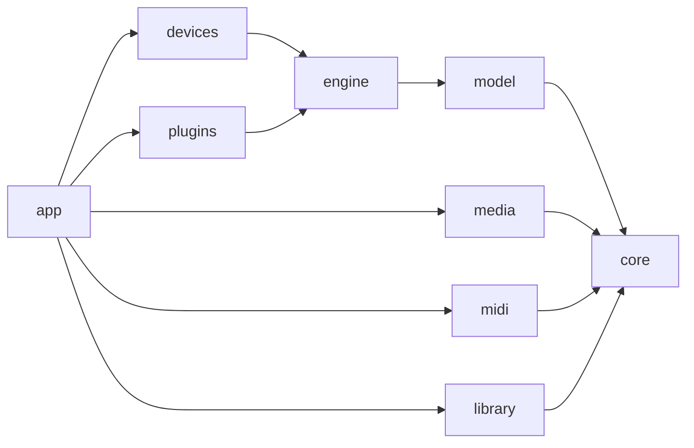

# Architecture

Stack and library choices: [stack.md](stack.md).

## Modules

One directory and one CMake target per module. Every module starts with a small working piece and a test, so work begins on a building base.

| Directory | Target | Area | Contains today | Grows into |
|---|---|---|---|---|
| `src/core` | `sessionflow_core` | shared | Audio buffer, MIDI event, sample and tick time, SPSC queue, smoother, real-time marker, spdlog | Shared primitives only |
| `src/model` | `sessionflow_model` | Engine | Immutable `Project`, tracks, audio and MIDI clips, notes, automation lanes and tempo map on immer | Full model, edit commands, undo, project file |
| `src/engine` | `sessionflow_engine` | Engine | `Processor` contract, `AudioIo` device streams and device listing with RtAudio | Transport, graph, mixer, recording, bounce |
| `src/media` | `sessionflow_media` | Plugins | WAV, FLAC and MP3 decoding and streaming with dr_libs, resampling with r8brain | Warping, peak cache |
| `src/midi` | `sessionflow_midi` | Plugins | MIDI inputs with libremidi, hot-plugging, timestamped handoff to the audio thread | Recording, quantize |
| `src/plugins` | `sessionflow_plugins` | Plugins | Default VST3 and CLAP folders per platform | Host process, IPC, VST3, CLAP, AU, scanner |
| `src/devices` | `sessionflow_devices` | Devices | `GainDevice`, the reference `Processor` | Built-in effects and instruments |
| `src/library` | `sessionflow_library` | App | SQLite connection wrapper | Library index, folder scanning |
| `src/app` | `sessionflow` | App | SDL3 window with Dear ImGui | All UI |

Dependencies point one way. Nothing depends on `app`, and `core` depends on nothing of ours.

## Contracts between areas

| Contract | Header | Implemented or used by |
|---|---|---|
| `Processor` | `engine/processor.hpp` | Plugin host nodes, built-in devices, clip players, mixer stages |
| `AudioBufferView`, `AudioBuffer` | `core/audio_buffer.hpp` | Everything that touches audio |
| `MidiEvent` | `core/midi_event.hpp` | MIDI input, MIDI clips, instruments |
| `SpscQueue` | `core/spsc_queue.hpp` | MIDI input, meters, snapshot handoff, recording |
| `LinearSmoother` | `core/smoother.hpp` | Mixer, built-in devices |
| `AudioCallback` | `engine/audio_callback.hpp` | The engine graph root, `tools/audio_check` |
| `SampleCount` | `core/time.hpp` | Transport, processors, audio file offsets |
| `TickCount`, `ticksPerBeat` | `core/time.hpp` | Model, transport, automation |

Change a contract in its own PR and ask the areas that use it to review.

## Threads

| Thread | Does | Never |
|---|---|---|
| Audio | Reads model snapshots, runs processors, pushes to queues | Allocates, locks, does I/O, logs, throws |
| UI | Builds edit commands, reads meters and state | Waits on the audio thread |
| Workers | Disk streaming, peaks, scanning, saving, freeing old snapshots | Touches UI state |

Mark audio-thread functions `SESSIONFLOW_NONBLOCKING` from `core/realtime.hpp`. Clang 20+ then rejects blocking calls inside them.

## Adding code

- New library: declare it in `cmake/Dependencies.cmake`, pinned to a tag or commit, and link it privately from the module that owns it.
- New module: add `src/<name>` with its own target when the first issue needs it, and add a row above.
- Tests go in `tests/`, one file per unit. DSP helpers are in `tests/support/signals.hpp`.
- Tests that need audio hardware carry the hidden tag `[.hardware]`, so CI skips them. Run them with `sessionflow_tests "[hardware]"`. `sessionflow_audio_check` in `tools/` plays a sine and reports late blocks, for example `--api WASAPI --buffer 64`.
- Branch per Linear issue, named `<type>/sf-<number>-<short-slug>` with the Conventional Commits type, for example `feat/sf-9-rtaudio-device-io`. The issue ID links the PR in Linear.
- PR title in Conventional Commits form, like the commits. Open it against `main` and keep CI green.
